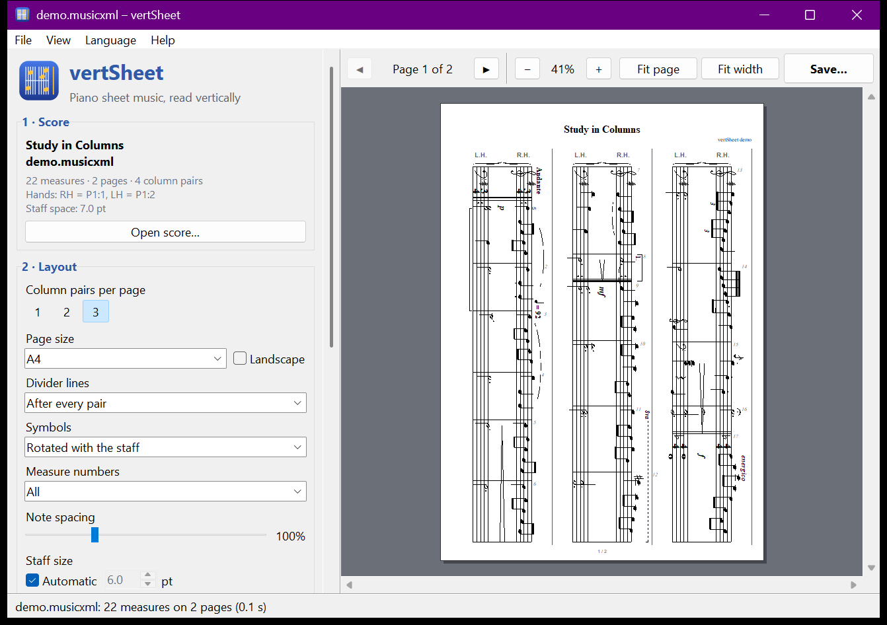
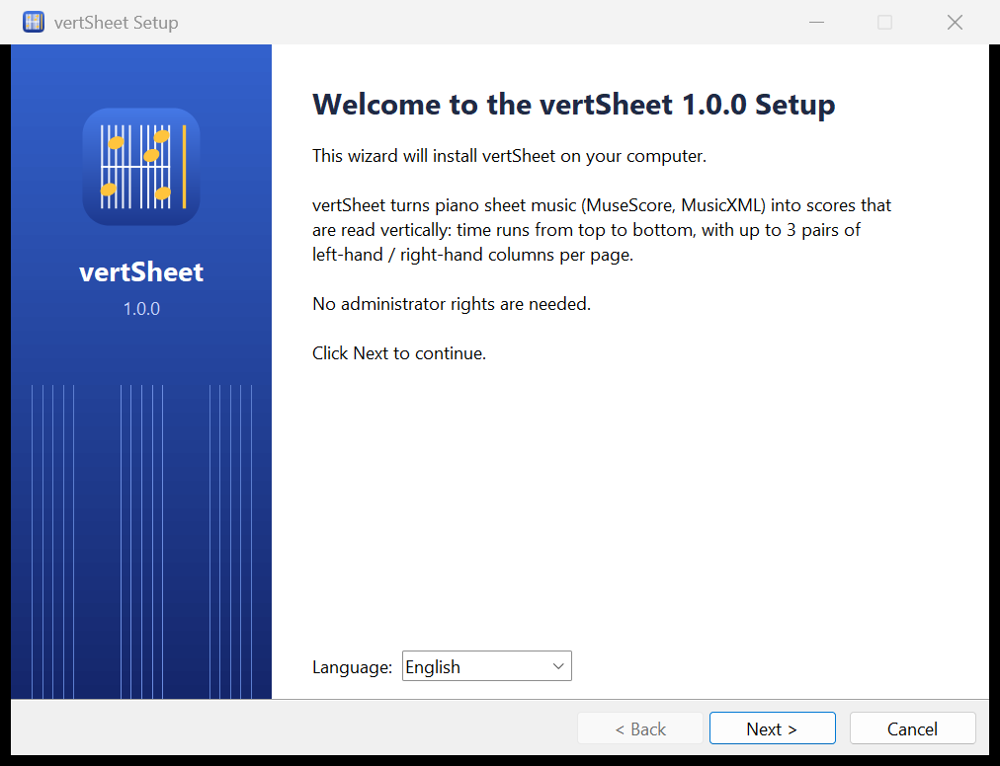

# vertSheet

vertSheet re-engraves piano sheet music so it is read **vertically**.

**[⬇ Download for Windows](../../releases/latest)** — `vertSheet-Setup-1.0.0.exe`
(installer) or `vertSheet-1.0.0-portable.zip` (no installation).



* Time runs from the **top of the page to the bottom**.
* Each page holds **at most 3 pairs of columns**. Every pair is one system:
  the **left-hand** staff (left column) and the **right-hand** staff (right
  column), rotated so that pitch rises to the right, just like on the keyboard.
* Pairs are read **left to right**: read pair 1 top to bottom, then pair 2, then pair 3, then turn the page.
* A **divider line** is drawn after every pair.
* Both hands share one time grid, so notes that sound together are always at
  the same height, with barlines running across the pair.

```
 ┌──────────── page ────────────────────────────┐
 │  L.H.  R.H.  │  L.H.  R.H.  │  L.H.  R.H.  │
 │  ║║║║  ║║║║  │  ║║║║  ║║║║  │  ║║║║  ║║║║  │
 │  ║║║║  ║║║║  │  ║║║║  ║║║║  │  ║║║║  ║║║║  │
 │  ─────────── │  ─────────── │  ─────────── │  ← barlines
 │  ║║║║  ║║║║  │  ║║║║  ║║║║  │  ║║║║  ║║║║  │
 │    pair 1  ↓ │    pair 2  ↓ │    pair 3  ↓ │
 └──────────────────────────────────────────────┘
                 ↑ divider lines
```

It is written in pure Python (3.9+) and needs **no third-party packages**: it
has its own MusicXML and MuseScore readers, layout engine, vector glyphs, and
PDF/SVG writers. It comes as a Windows program with a graphical interface and
an installation wizard, and as a command-line tool. See
[examples/demo_vertical.pdf](examples/demo_vertical.pdf) for a result.

## Quick start (Windows)

1. Download **`vertSheet-Setup-1.0.0.exe`** from the
   [Releases](../../releases/latest) page, run it and follow the installation
   wizard (no administrator rights needed). Or download
   `vertSheet-1.0.0-portable.zip`, unzip it and run `vertSheet.exe`.
   If Windows says "Windows protected your PC" (the program is not digitally
   signed), choose *More info* > *Run anyway*.
2. Start vertSheet from the Start menu or the desktop and click
   **Open score…** (a MuseScore `.mscz`/`.mscx` or MusicXML file), or
   right-click a score > *Open with* > vertSheet.
3. Adjust the layout on the left (column pairs, page size, divider lines,
   spacing…): the preview on the right updates by itself.
4. **Convert and save…** writes the PDF (or SVG or HTML).

To uninstall: Settings > Apps > Installed apps > vertSheet > Uninstall.

## The Windows program

`vertSheet.exe` opens a window with the settings on the left and a live
preview of the vertical pages on the right:

* **Score**: open a file (Ctrl+O, the recent-files menu, or "Open with" from
  Explorer); the title, number of measures/pages/column pairs and the hand
  assignment are shown.
* **Layout**: column pairs per page (1-3), page size and orientation, divider
  lines, rotated or upright symbols, measure numbers, note spacing, staff size,
  hand labels, last-column justification.
* **Hands**: automatic, or split a single staff at a pitch.
* **Titles**: override the title and composer.
* **Export**: PDF, SVG (one file per page) or HTML; then open the file or
  its folder.

The preview is drawn natively (page navigation with PgUp/PgDn or the mouse
wheel, zoom with Ctrl+wheel or Ctrl +/-, fit page / fit width). Layout runs in
the background, so the window stays responsive with long scores. The interface
is in English, Italian and French (Language menu; detected automatically), and the
engraved hand labels follow it (L.H./R.H., M.S./M.D., or M.G./M.D.). Settings and recent
files are remembered in `%APPDATA%\vertSheet\settings.json`.

### Installation wizard



`vertSheet-Setup-<version>.exe` installs per user, into
`%LOCALAPPDATA%\Programs\vertSheet` (or a folder of your choice), with:
welcome and language page > destination folder (space required/available) >
options (desktop shortcut, Start menu shortcut, "Open with" for .mscz, .mscx,
.musicxml and .mxl - default apps are not changed -, `vertsheet-cli` on the
PATH) > summary > progress > finish ("Launch vertSheet now"). Running it again
upgrades the existing installation.

Everything Setup creates is recorded in `install.json` in the installation
folder; **Uninstall** (Settings > Apps, or `vertSheet.exe --uninstall`)
removes exactly those files, shortcuts and registry entries and leaves any
other file in the folder alone.

Unattended use: `vertSheet-Setup-1.0.0.exe /S [/D=FOLDER] [/NODESKTOP]
[/NOSTARTMENU] [/NOASSOC] [/PATH] [/LANG=it|en]` and
`vertSheet.exe --uninstall --quiet`.

The executables are not code-signed, so Windows SmartScreen may show "Windows
protected your PC" the first time: choose *More info* > *Run anyway*.

### Building the program and the installer

```bash
python tools/build_windows.py
```

runs the tests, draws the icon (`tools/make_icon.py`), freezes the program
with PyInstaller (installed automatically into a private build environment in
`%TEMP%\vertSheet-build`, not into your Python), checks the frozen program,
builds the wizard and the portable zip into `dist/`, and finally installs the
new setup into a sandbox (separate registry key and folders), runs the
installed program and uninstalls it again, verifying that nothing is left
behind.

## Quick start (command line)

```bash
python -m vertsheet song.musicxml                 # -> song_vertical.pdf
python -m vertsheet song.mscz -o song.pdf          # MuseScore files are read directly
python -m vertsheet song.mxl --format all          # PDF + SVG pages + HTML viewer
```

To try the included demo:

```bash
python examples/make_demo.py                       # writes examples/demo.musicxml
python -m vertsheet examples/demo.musicxml
```

To install it as a command, run `pip install -e .` and then use `vertsheet song.musicxml`
(`vertsheet-gui`, or `python -m vertsheet` without arguments, opens the window).

## Input formats

| Format | How |
|---|---|
| `.musicxml`, `.xml`, `.mxl` (partwise or timewise) | native |
| `.mscz`, `.mscx` (MuseScore 1, 2, 3 and 4) | native; MuseScore is not needed |
| `.mid`, `.midi`, `.gp*`, `.cap*`, … | converted automatically if MuseScore is installed |
| scanned `.pdf`, `.png`, `.jpg`, `.tif` | optical recognition through [Audiveris](https://audiveris.github.io) if it is installed |

For a printed or scanned score without Audiveris, first convert it to MusicXML
with any OMR tool (Audiveris, PlayScore, SmartScore, MuseScore's import), then
pass the MusicXML to vertSheet.

### Which staff is which hand?

* A part with two staves (a normal piano part): staff 1 is the RH and staff 2 is the LH.
* Two separate parts: the first part is the RH and the second is the LH.
* A single staff: the notes are split between the hands at middle C (`--split`
  changes the point).
* You can choose explicitly with `--rh P1:1 --lh P1:2`. Parts can be given by
  id or by number, e.g. `--rh 2 --lh 3`.

## Options

| Option | Meaning |
|---|---|
| `--pairs 1\|2\|3` | pairs of columns per page (maximum and default 3) |
| `--page a4\|a3\|a5\|letter\|legal\|tabloid\|210x297mm` | page size; append `-landscape` for landscape |
| `--divider after\|between\|none` | a line after every pair (default), only between pairs, or none |
| `--symbols rotated\|upright` | clefs, rests, accidentals and texts rotated with the staff (default), or upright |
| `--staff-space PT` | staff size; the default fills the pair width, up to 7 pt |
| `--spacing F` | more (>1) or less (<1) vertical room per note |
| `--measure-numbers all\|system\|none` | which bar numbers to show |
| `--no-labels` | hide the "L.H. / R.H." column labels |
| `--justify-last` | stretch the last column down to the bottom of the page |
| `--split C4` | split a single staff between the hands at a pitch |
| `--title`, `--composer` | override the metadata |
| `--format pdf\|svg\|html\|all`, `-o FILE` | output format and file |
| `--debug` | draw the collision boxes |

## What is engraved

Clefs (including mid-measure changes and octave clefs), key and time
signatures and their changes, noteheads (black, half, whole, breve, x),
seconds in chords, ledger lines, stacked accidentals in chords (taken from the
file, or computed from the key when the file has none), dots, stems, flags,
beams from the file or automatic, with secondary beams and hooks, rests and
whole-bar rests, multiple voices, grace notes (with the acciaccatura slash),
cue notes, tuplets (number or bracket), ties (also across columns), slurs that
curve around the notes in between, staccato, accent, tenuto, marcato,
staccatissimo, fermatas, trills, mordents, turns, arpeggios, fingerings,
dynamics, hairpins, text, tempo with metronome mark, rehearsal marks, pedal
lines, 8va/8vb/15ma lines (the notes are moved accordingly), repeat barlines,
volta brackets, and double and final barlines.

## How it works

```
vertsheet/
  musicxml.py   MusicXML reader + assignment of staves to hands
  mscx.py       native MuseScore reader (pitches spelled from tpc + MIDI)
  analyze.py    clef/8va positions, accidentals, beams, stems, seconds, extents
  layout.py     spacing by duration, shared LH/RH time grid, column breaking,
                justification, page geometry (<= 3 pairs per page)
  engrave.py    4-pass engraver: notes -> beams -> ties/slurs/tuplets ->
                dynamics/text/lines with collision avoidance
  glyphs.py     vector music symbols (no music font needed)
  canvas.py     display list + SVG writer + dependency-free PDF writer
  convert.py    optional MuseScore / Audiveris conversion
  gui.py        the window (Tkinter): settings sidebar + live preview
  preview.py    draws the display list on a Tk canvas
  i18n.py       Italian / English / French interface strings
  app.py        entry point of vertSheet.exe (window, --uninstall)
  winsetup.py   per-user install / uninstall: files, shortcuts, "Open with",
                PATH, Installed-apps entry, install.json manifest
installer/
  wizard.py     the setup wizard (frozen into vertSheet-Setup-<version>.exe)
  entry_gui.py, entry_cli.py   PyInstaller entry points
tools/
  build_windows.py   builds program + wizard + portable zip, with self-tests
  make_icon.py       draws the icon (assets/vertsheet.ico + PNGs)
```

Spacing follows the usual engraving rule: the space after a note grows with the
logarithm of its duration. It also respects minimum distances for accidentals,
dots and displaced seconds. Bars are packed into columns, and each column is
then justified to fill the page height by solving for a single stretch factor.

## Tests

```bash
python -m unittest discover -s tests -v
```

The tests cover the music engine, the window (opening, preview, navigation,
export, language switch) and, on Windows, the installer in a sandbox.

## Limitations

Lyrics, chord symbols, figured bass, cross-staff beams and multi-bar rest
symbols are not drawn. Printed images of music need an OMR program (see
above), because vertSheet works from symbolic notation, not from pixels.

Keep your own scores and their conversions in a `local/` folder: it is
git-ignored, so they are never published by accident.

## Changes and license

See [CHANGELOG.md](CHANGELOG.md). vertSheet is released under the
[MIT License](LICENSE).
